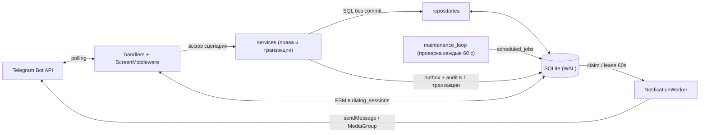

<div align="center">

# 🐾 Pet Finder Bot

**Telegram-бот для поиска потерянных и найденных животных в Новосибирске**

Пошаговые анкеты с альбомами фото, локальное определение района по геопозиции без внешних геокодеров, лента для волонтёров, модерация и транзакционная очередь уведомлений на базе `aiogram 3` и `SQLite`.

[](https://www.python.org/)
[](https://docs.aiogram.dev/)
[](https://www.sqlite.org/)
[](domain/GEODATA.md)

[Возможности](#возможности) •
[Быстрый старт](#быстрый-старт) •
[Команды и сценарии](#команды-и-сценарии) •
[Архитектура](#архитектура) •
[Уведомления](#доставка-уведомлений-и-диагностика) •
[Тестирование](#тестирование)

</div>

---

## Возможности

### Для владельцев и нашедших животных
- **Два сценария создания анкеты:**
  - **«Я потерял животное»** (5 шагов): до 10 фото (включая загрузку альбомом), кличка, приметы, район Новосибирска, дополнительная информация и экран предпросмотра.
  - **«Я нашёл животное»** (4 шага): до 10 фото (или альбом), район, описание животного и обстоятельств находки, предпросмотр перед отправкой.
- **Защита от повторной отправки:** черновик привязан к уникальному `submission_key`, поэтому повторное нажатие подтверждения не создаёт дубликаты.
- **Управление анкетами («Мои анкеты»):** просмотр счётчиков просмотров и откликов, постановка на паузу, возобновление, закрытие при нахождении питомца, мягкое удаление (корзина с хранением 7 дней) и безвозвратное удаление.
- **Автонапоминания:** через 7 дней после публикации активной анкеты бот однократно спрашивает автора, удалось ли найти питомца.

### Для волонтёров и помощников
- **Лента поиска («Помочь в поиске»):** просмотр активных анкет по выбранному району или по всему Новосибирску в формате карточек (`❌ Не видел` / `✅ Видел`).
- **Быстрый отклик:** сообщение с местом и временем встречи отправляется владельцу в очередь уведомлений и увеличивает счётчик откликов анкеты.
- **Гибкие уведомления («Настройки»):** подписка на новые публикации по своему району, по всему городу или полное отключение уведомлений.

### Локальное определение района
- Кнопка **«📍 Не знаю, подскажите мне»** определяет один из 10 районов Новосибирска офлайн по локальному снимку границ OpenStreetMap ([`domain/novosibirsk-districts.geojson`](domain/novosibirsk-districts.geojson)), после чего просит пользователя подтвердить результат.
- Координаты обрабатываются только в памяти: они не записываются в базу данных, FSM-хранилище или логи и не отправляются внешним геокодерам.
- Сообщение с геопозицией удаляется сразу после обработки (если это разрешено ограничениями Telegram). Для точек за пределами города предлагается ручной выбор района.

### Модерация, безопасность и чистый чат
- **Панель администратора:** очередь модерации с фотографиями и кнопками одобрения/отклонения прямо в чате модераторов, рассмотрение жалоб, статистика (пользователи, статусы анкет, жалобы, очередь и ошибки уведомлений), управление блокировками и просмотр журнала действий.
- **Автофильтр контента:** проверка текстовых полей на стоп-слова сбора средств, ссылки, телефоны, номера карт и замаскированную ненормативную лексику (`utils/blacklist.py`).
- **Чистый интерфейс (`ScreenMiddleware`):** промежуточные шаги форм, меню и пользовательский ввод удаляются при переходе к следующему экрану, а квитанции о важных действиях и уведомления сохраняются даже после перезапуска бота (история сообщений до включения учёта не затрагивается из-за ограничений Bot API).
- **Соответствие 152-ФЗ:** при первом запуске запрашивается согласие на обработку персональных данных; команда `/delete_my_data` полностью удаляет профиль, анкеты, отклики, жалобы, диалоговые сессии, историю экранов и связанные уведомления.

> [!NOTE]
> Бот полностью безвозмездный и волонтёрский: при первом входе и в текстах анкет действует антимошеннический фильтр, предупреждающий пользователей о запрете денежных переводов.

---

## Команды и сценарии

| Команда / Раздел | Назначение |
| :--- | :--- |
| `/start` | Первичное знакомство (согласие 152-ФЗ), сброс активного шага, открытие главного меню |
| `/set_district` | Выбор или смена района Новосибирска (вручную или по геопозиции) |
| `/delete_my_data` | Полное удаление всех пользовательских данных и связанных записей из базы |
| **🐾 Я потерял животное** | Мастер создания анкеты о пропавшем питомце (5 шагов) |
| **🔎 Я нашёл животное** | Мастер создания анкеты о найденном животном (4 шага) |
| **🤝 Помочь в поиске** | Лента анкет по району или всему городу с отправкой откликов |
| **📋 Мои анкеты** | Управление статусами (`moderation`, `active`, `paused`, `closed`, `deleted`) и статистикой |
| **⚙️ Настройки** | Выбор режима уведомлений (`Только мой район` / `Со всего Новосибирска` / `Отключить`) |
| **💬 Поддержка** | Отправка сообщения об ошибке, идеи или жалобы на анкету по её ID |
| **🛠 Режим администратора** | Встроенная панель модерации (доступна только пользователям из `ADMIN_IDS`) |

---

## Быстрый старт

### Требования
- **Python 3.10+** (зависимости закреплены в [`requirements.txt`](requirements.txt): `aiogram==3.28.2`, `aiosqlite==0.22.1`, `python-dotenv==1.2.2`).
- Токен Telegram-бота от [@BotFather](https://t.me/BotFather).

### Установка и запуск (Windows PowerShell)

```powershell
git clone https://github.com/dan704065/pet-finder-bot.git
cd pet-finder-bot

python -m venv venv
.\venv\Scripts\Activate.ps1
pip install -r requirements.txt
```

Создайте файл `.env` рядом с `bot.py` и укажите токен (и при необходимости ID модераторов):

```env
BOT_TOKEN=123456:ABC-DEF_your_bot_token
ADMIN_IDS=123456789,987654321
```

Запустите бота:

```powershell
python bot.py
```

<details>
<summary>Запуск на Linux / macOS (bash / zsh)</summary>

```bash
git clone https://github.com/dan704065/pet-finder-bot.git
cd pet-finder-bot

python3 -m venv venv
source venv/bin/activate
pip install -r requirements.txt

cat <<'EOF' > .env
BOT_TOKEN=123456:ABC-DEF_your_bot_token
ADMIN_IDS=123456789,987654321
EOF

python3 bot.py
```

</details>

### Переменные окружения

| Переменная | Обязательна | По умолчанию | Описание |
| :--- | :---: | :--- | :--- |
| `BOT_TOKEN` | Да | — | Токен Telegram-бота из BotFather |
| `ADMIN_IDS` | Нет | `""` | Telegram ID администраторов/модераторов через запятую |
| `DATABASE_PATH` | Нет | `database.db` (рядом с `bot.py`) | Путь к файлу базы данных SQLite |
| `LOG_PATH` | Нет | `logs/bot.log` (рядом с `bot.py`) | Путь к ротируемому файлу логов (5 МБ, до 3 бэкапов) |

> [!TIP]
> Файл `.env` загружается автоматически из каталога проекта (приоритет у уже заданных переменных окружения ОС). Также сохранена обратная совместимость с приватным `config.py` (см. [`config.example.py`](config.example.py)). Секреты, базы данных и логи исключены из Git через [`.gitignore`](.gitignore).
>
> Чтобы модераторы из `ADMIN_IDS` получали запросы на проверку анкет в личный чат, каждый модератор должен сначала открыть бота и нажать `/start`. При запуске бот также доотправляет в очередь ещё не поставленные запросы по анкетам в статусе `moderation`.

---

## Архитектура

Один процесс обслуживает Telegram polling, состояния диалогов, фоновую доставку уведомлений и ежедневное обслуживание базы данных. Изоляция событий пользователя выполняется внутри процесса (`SimpleEventIsolation`), поэтому конфигурация рассчитана на **один запущенный экземпляр бота на одну базу данных**.



### Структура проекта

```text
pet-finder-bot/
├── bot.py                 # Сборка зависимостей, polling и запуск фоновых задач
├── settings.py            # Явная загрузка конфигурации (.env / env / config.py)
├── manage.py              # Локальная CLI-диагностика очереди уведомлений
├── config.example.py      # Пример legacy-конфигурации config.py
├── requirements.txt       # Зафиксированные версии зависимостей
├── domain/                # Модели (dataclass), статусы (Enum), валидация, GeoJSON районов и GEODATA.md
├── handlers/              # Сценарии Telegram: onboarding, location, applications, search,
│                          # settings, support, moderation, navigation и middleware ошибок
├── keyboards/             # Inline-клавиатуры и навигация меню
├── presentation/          # Карточки анкет, тексты дисклеймеров и рендер уведомлений
├── repositories/          # SQL-запросы и маппинг строк в типизированные модели
├── database/              # Соединения SQLite (PRAGMA WAL, FK, busy_timeout) и миграции
├── storage/               # SQLiteStorage для сохранения FSM-состояний и черновиков
├── services/              # Бизнес-правила, проверка прав доступа и транзакции сценариев
├── workers/               # Асинхронный воркер доставки из notification_outbox
├── utils/                 # Экранирование HTML, антиспам-фильтр, логгер и ScreenMiddleware
└── tests/                 # Архитектурные, регрессионные и UX/гео-тесты
```

### Инварианты слоёв
- **Обработчики (`handlers/`):** принимают ввод от Telegram, делегируют бизнес-логику в сервисы и отображают результат.
- **Сервисы (`services/`):** проверяют права доступа (независимо от Telegram-фильтров) и бизнес-ограничения, объединяя изменения сущностей, аудит и постановку уведомлений в одну транзакцию (`BEGIN IMMEDIATE`).
- **Репозитории (`repositories/`):** инкапсулируют SQL-запросы, преобразуют строки в именованные модели `domain/` и не вызывают `commit()` самостоятельно.

---

## Хранение данных и миграции

- **Автоматические миграции:** при каждом запуске `migrate()` проверяет таблицу `schema_migrations` и применяет недостающие версии схемы (`initial_schema`, `durable_workflows`, `chat_screens_and_photos`). Поддерживается обновление существующей базы предыдущей версии без таблицы миграций с сохранением пользователей и анкет.
- **Параметры SQLite:** каждое соединение включает `PRAGMA foreign_keys = ON` и `PRAGMA busy_timeout = 10000`; база работает в режиме `WAL`.
- **Сохранность диалогов:** состояния FSM и ключи отправки черновиков хранятся в `dialog_sessions`, благодаря чему заполнение анкеты можно продолжить после перезапуска бота.
- **Ежедневное обслуживание (`scheduled_jobs`):** время следующего запуска сохраняется в базе, поэтому перезапуск не сдвигает суточный таймер. Удалённые анкеты старше 7 дней очищаются вместе с откликами, жалобами и очередью уведомлений; для активных анкет старше 7 дней однократно ставится напоминание (`application_reminders`).

> [!IMPORTANT]
> Перед обновлением работающего бота сделайте резервную копию базы данных. При активном режиме `WAL` используйте SQLite Backup API либо полностью остановите процесс перед копированием файла `database.db`.

---

## Доставка уведомлений и диагностика

Все исходящие уведомления (модераторам, авторам, подписчикам районов, отклики, жалобы и напоминания) записываются в таблицу `notification_outbox` **в той же транзакции**, что и изменение анкеты или обращение:

- **Сетевые сбои и ошибки API:** автоматический повтор с экспоненциальной задержкой (до 8 попыток, максимум до 1 часа между попытками).
- **Ограничения Telegram (`RetryAfter`):** доставка глобально приостанавливается в `scheduled_jobs` на указанный Telegram срок и учитывает паузу даже после перезапуска процесса.
- **Постоянные ошибки (`Forbidden`, `BadRequest`):** задача переводится в статус `failed`, чтобы не блокировать остальную очередь, а ошибка фиксируется в логах и отображается в статистике администратора.
- **Аренда и гарантия доставки:** воркер блокирует задачу на 60 секунд (`locked_until`). При аварийной остановке процесса задача снова станет доступной по истечении аренды. Гарантия доставки — *at-least-once* (при сбое после ответа Telegram и до записи в БД возможен повтор; длинные старые записи разбиваются на части). Журнал доставленных заданий хранится до удаления данных пользователя (`/delete_my_data`) или связанной анкеты.

### Локальная диагностика через `manage.py`

Утилита работает напрямую с файлом SQLite без `BOT_TOKEN` и подключения к Telegram:

```powershell
# Показать список неудачных уведомлений (до 20 последних)
python manage.py --database database.db notifications

# Повторно поставить конкретное уведомление в очередь (например, #12)
python manage.py --database database.db retry-notification 12
```

Повторную отправку выполнит запущенный процесс `bot.py`.

---

## Геоданные и приватность

- Снимок границ 10 районов Новосибирска ([`domain/novosibirsk-districts.geojson`](domain/novosibirsk-districts.geojson)) получен из OpenStreetMap через Nominatim; подробности лицензирования (`ODbL 1.0`) и обновления набора описаны в [`domain/GEODATA.md`](domain/GEODATA.md).
- Координаты пользователей никогда не сохраняются на диск и не покидают процесс бота.

---

## Тестирование

Набор тестов проверяет пользовательские и админские сценарии, проверку прав на уровне сервисов, миграции, откат транзакций, идемпотентность отправки, сохранение состояний и квитанций после перезапуска, повторную доставку уведомлений и точность геоопределения всех 10 районов:

```powershell
python -m unittest discover -s tests -v
```

Тесты используют временные SQLite-базы и имитацию Telegram Bot API — реальный `BOT_TOKEN`, файл `.env` и доступ к сети не требуются.
